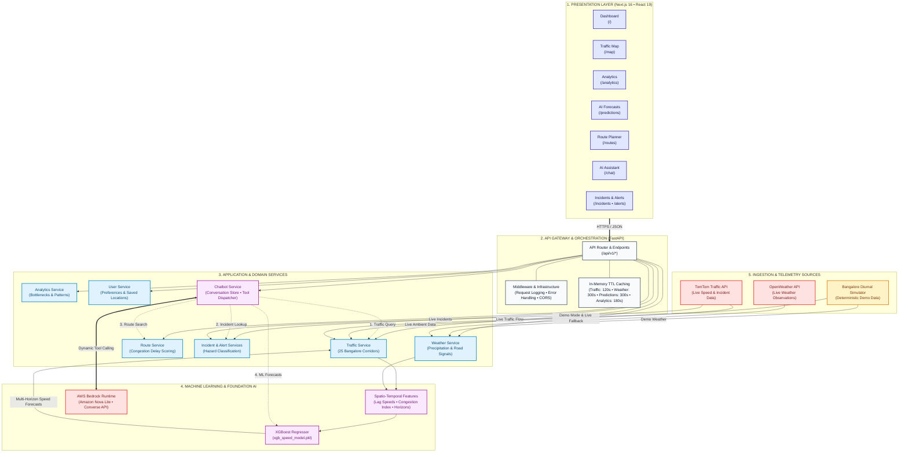
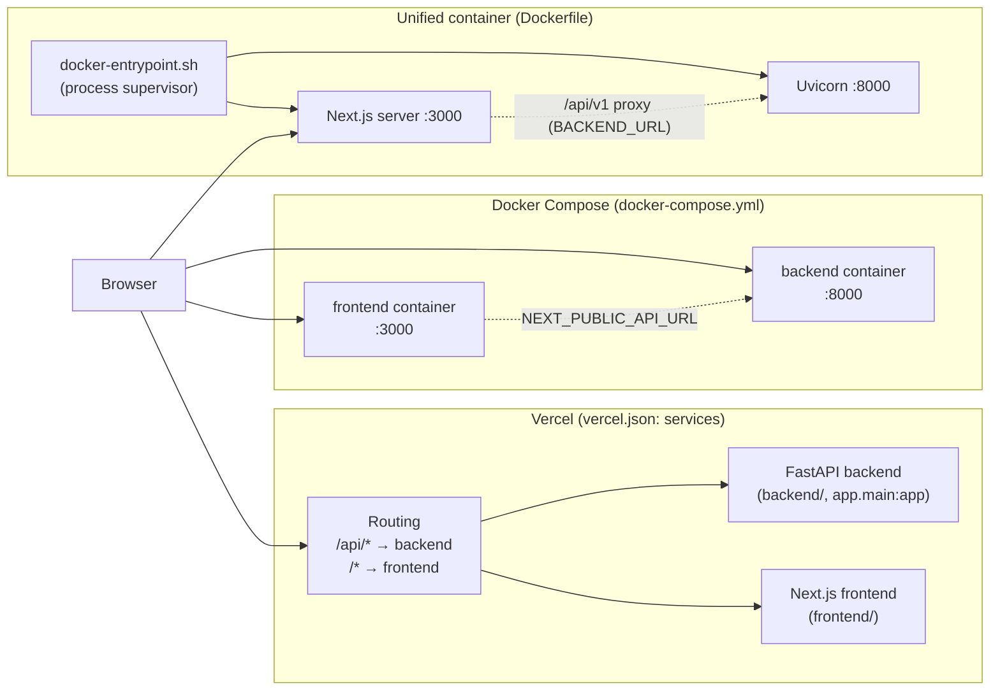
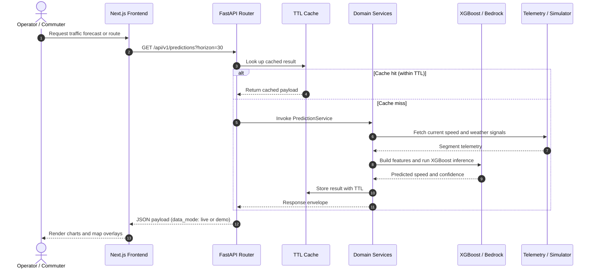

# TrafficSense.AI

<p align="center">
  
  
  
  
  
  
  
  
  
  
</p>

<p align="center">
  <strong>Urban traffic monitoring, machine learning speed forecasting, and a conversational operations assistant for Bangalore, India.</strong>
</p>

<p align="center">
  <a href="#quickstart">Quickstart</a> •
  <a href="#key-features">Features</a> •
  <a href="#architecture">Architecture</a> •
  <a href="#frontend">Frontend</a> •
  <a href="#ai-assistant--bedrock-integration">AI Assistant</a> •
  <a href="#ai--ml-pipeline">ML Pipeline</a> •
  <a href="#api-reference">API Reference</a> •
  <a href="#testing--quality-assurance">Testing</a> •
  <a href="#deployment">Deployment</a>
</p>

---

## Overview

**TrafficSense.AI** is an urban traffic intelligence platform for the arterial road network of **Bangalore, India**. It combines traffic telemetry across 25 monitored corridors, local weather signals, XGBoost speed forecasts, an analytics dashboard, and a **conversational assistant powered by AWS Bedrock** that answers operator questions by calling backend domain services as tools.

The platform runs against live external data (TomTom Traffic API and OpenWeather) or in a self-contained simulated mode (`DEMO`) that requires no API credentials. Both modes serve traffic operators, urban planners, and commuters.

---

## Problem & Solution

### The Challenge
Bangalore is among the most congested metropolitan areas in the world. Corridors such as Central Silk Board, KR Puram, Tin Factory, Hebbal Flyover, and the Outer Ring Road technology corridor experience severe and volatile delays. Common navigation tools have three shortcomings:

1. **Fragmented information:** Congestion data, weather, road hazards, and routing are rarely available in a single operational view.
2. **Reactive indicators:** Most tools describe current conditions but offer little short-horizon forecasting (15, 30, and 60 minutes ahead) to help users avoid congestion before departure.
3. **Fragile dependencies:** Many platforms become unavailable when external API quotas or subscriptions lapse, with no graceful fallback.

### The TrafficSense.AI Approach
* **Hybrid data ingestion:** Switches between live external APIs (TomTom and OpenWeather) and a deterministic, time-varying Bangalore simulation (`DEMO` mode) calibrated to morning and evening peak patterns. Live failures fall back to demo data automatically.
* **XGBoost forecasting:** Regression models predict corridor speed and congestion ratio up to 60 minutes ahead.
* **Congestion-aware routing:** Evaluates alternative corridors between major Bangalore hubs and scores them with congestion penalties.
* **Conversational assistant (AWS Bedrock):** Uses Amazon Nova Lite with tool calling to answer multi-turn questions about speeds, forecasts, incidents, and routes.
* **Modern web frontend:** Built on Next.js 16 (Turbopack), React 19, Tailwind CSS, Leaflet, and Recharts, with keyboard-driven navigation (`⌘K`).

---

## Key Features

* **25 monitored Bangalore corridors:** Real-time speeds, free-flow baselines, and delays for corridors including Outer Ring Road, Silk Board, Whitefield, Electronic City Flyover, Indiranagar 100ft Road, MG Road, Hebbal, KR Puram, and Sarjapur Road.
* **Normalized congestion index:** A clamped ratio that describes how far current speed falls below free-flow speed:
  $$\text{congestion\_ratio} = \text{clamp}\left(1 - \frac{v_{\text{current}}}{v_{\text{free\_flow}}},\, 0,\, 1\right)$$
  The ratio is classified into four tiers:
  * **Free flow (`LOW`):** below 0.25
  * **Moderate (`MODERATE`):** 0.25 to 0.49
  * **Heavy (`HIGH`):** 0.50 to 0.74
  * **Severe (`SEVERE`):** 0.75 and above
* **Multi-horizon ML forecasts:** Segment speed and congestion predictions for 15, 30, and 60 minutes ahead.
* **Conversational traffic assistant:** Natural-language operations assistant backed by AWS Bedrock (`amazon.nova-lite-v1:0`), with seven backend tools and multi-turn context.
* **Interactive map:** Leaflet-based geospatial view with color-coded corridor polylines, layer toggles (flow, incidents, roadworks, closures, CCTV), and a road detail drawer.
* **Analytics suite:** Citywide congestion distribution, 24-hour speed versus congestion trends, bottleneck rankings, and CSV export.
* **Incident management:** Filterable records of accidents, construction, and road closures, including lane blockage details and estimated clearance times.
* **Route comparison:** Origin-to-destination pathfinding with landmark presets, congestion avoidance, and turn-by-turn previews.
* **Alerts feed:** Notifications for sudden congestion spikes, hazardous weather, and critical road blockages.

---

## Architecture



### Deployment Topology

The same codebase runs in three configurations. In every configuration the browser talks to a single origin, and requests under `/api/v1` reach the FastAPI backend.



### End-to-End Request & Inference Lifecycle



### Caching & Fallback Behavior

* **Per-resource TTL caches** (`cachetools`) are configured in `backend/app/core/config.py`: traffic 120 s, weather 300 s, predictions 300 s, and analytics 180 s.
* **Serialized live fetches:** Concurrent cold requests (the dashboard loads traffic, alerts, and predictions at once) share a single TomTom fetch round through a lock, instead of issuing duplicate upstream calls.
* **Partial live results:** When some corridors return no live data, the service reports the missing segments by name rather than failing the whole response. Those segments are cached with a short TTL so a stuck segment costs one upstream round per window.
* **Demo fallback:** If a live fetch fails, demo data is served from a short-lived fallback cache (20 s), so recovery to live data is picked up quickly once the upstream service is available again.

### Architectural Tier Breakdown

| Tier | Component | Primary Responsibility | Latency Target |
|---|---|---|---|
| **1. Presentation** | Next.js 16 (App Router) + React 19 + Tailwind CSS | Dashboard, interactive map, charts, route planner, and assistant console. Served by `next start`; not a static export. | Server-rendered |
| **2. Gateway** | FastAPI + Starlette + middleware | Route dispatch, Pydantic v2 validation, CORS, structured request logging, global error handling, and TTL caching. | Under 5 ms overhead |
| **3. Domain services** | Python 3.12 services | Corridor normalization, route delay scoring, incident tracking, user preferences, and Bedrock tool dispatch. | Under 15 ms |
| **4. AI / ML** | XGBoost regressor + AWS Bedrock | Nine-feature spatio-temporal speed forecasts (15, 30, and 60 minutes) and multi-turn reasoning with Amazon Nova Lite. | ML: under 20 ms; Bedrock: roughly 600–1200 ms |
| **5. Ingestion** | TomTom API + OpenWeather + diurnal simulator | Live telemetry with automatic fallback to simulated data when credentials are absent or the upstream fails. | Polling with TTL caching |

---

## Frontend

The frontend is a Next.js 16 application using the App Router, with a design system based on rounded cards (`rounded-2xl`), subtle borders, soft shadows, and an indigo brand accent (`oklch(0.38 0.16 262)` / `#2563eb`). It is designed for desktop workstations, tablets, and field devices.

### Core Frontend Architecture
* **Framework:** Next.js 16.3 (App Router with Turbopack) and React 19.
* **Global command menu (`⌘K`):** Keyboard-driven search for moving between pages and zooming to specific corridors.
* **Responsive shell:** Collapsible sidebar, breadcrumbs, live telemetry indicators, and system health status.
* **API access:** A typed client in `frontend/src/lib/api/client.ts` calls `/api/v1` with relative paths. Next.js rewrites those requests to the backend in local and Docker deployments, and Vercel routes them directly.
* **Map tiles:** TomTom map tiles when `NEXT_PUBLIC_TOMTOM_API_KEY` is set; OpenStreetMap tiles otherwise (`frontend/src/lib/map-config.ts`).

### Views & Capabilities

| Route | View | Description |
|---|---|---|
| `/` | **Dashboard** | Operational overview with four KPI cards, a mini map, top congested corridors, a 24-hour speed and congestion trend, forecast summaries, and a weather advisory. |
| `/map` | **Traffic Map** | Full-screen geospatial view with a floating control bar, corridor search, congestion filter, layer toggles (flow, incidents, roadworks, closures, CCTV), and a road detail drawer. |
| `/analytics` | **Analytics & Trends** | Five charts: congestion distribution, 24-hour speed versus congestion, top bottleneck rankings, current versus free-flow speed, and incident classification, with CSV export. |
| `/predictions` | **AI Forecasts** | Forecasts for 15, 30, and 60 minutes, with corridor filters, speed deltas, confidence ratings, a projection timeline, and an overview of the XGBoost model. |
| `/routes` | **Route Planner** | Congestion-aware route search with origin and destination inputs, quick swap, landmark presets, fastest, balanced, and shortest alternatives, route polylines, and a turn-by-turn preview. |
| `/incidents` | **Incident Management** | Incident feed with summary counters, severity and type filters, verification status, affected lanes, estimated clearance time, and deep links to the map. |
| `/alerts` | **Alerts Feed** | Traffic alerts with an unread counter, severity filters, read and unread toggles, bulk "Mark all as read", and quick navigation actions. |
| `/chat` | **AI Traffic Assistant** | Conversational console with suggested prompts, multi-turn dialogue, tool execution status, Markdown responses, and action buttons ("View on Map", "Check Predictions", "Find Route"). |
| `/settings` | **Preferences & Health** | Operator preferences, corridor notification toggles (`PUT /api/v1/users/preferences`), map defaults, saved locations, and live backend and ML health diagnostics. |

---

## AI Assistant & Bedrock Integration

The assistant uses **AWS Bedrock** with **Amazon Nova Lite** (`amazon.nova-lite-v1:0`). It runs a tool-use loop: it interprets the request, calls backend domain tools, and writes a response grounded in the returned data.

### Tool Execution Flow

```
User query: "What is traffic like on Outer Ring Road and will it get worse in 30 minutes?"
   │
   ▼
POST /api/v1/chat ──► ChatbotService ──► Bedrock Converse API
                                            │
                              ┌─────────────┴─────────────┐
                              ▼                           ▼
                     Tool: get_current_traffic   Tool: get_traffic_prediction
                     (road: "Outer Ring Road")    (horizon: 30, road: "Outer Ring Road")
                              │                           │
                              └─────────────┬─────────────┘
                                            ▼
                           Model synthesizes live telemetry and forecast
                                            │
                                            ▼
            Response and UI actions (e.g. FOCUS_MAP with lat/lng) returned to the chat UI
```

### Available Domain Tools

| Tool Name | Domain Service | Description |
|---|---|---|
| `get_current_traffic` | `TrafficService` | Current speed, congestion ratio, and delays across the 25 corridors |
| `get_traffic_incidents` | `IncidentService` | Active accidents, closures, and hazards with severity |
| `get_weather` | `WeatherService` | Temperature, precipitation, humidity, wind, and visibility |
| `get_traffic_prediction` | `PredictionService` | XGBoost forecasts for 15, 30, or 60 minutes |
| `find_route` | `RouteService` | Congestion-penalized routes and alternatives between Bangalore landmarks |
| `get_traffic_analytics` | `AnalyticsService` | Citywide congestion averages and bottleneck rankings |
| `get_alerts` | `AlertsService` | Active high-priority traffic hazards and weather warnings |

### Context Memory
`ConversationStore` keeps a sliding window of the most recent 20 messages per `conversation_id` (`CHATBOT_MAX_HISTORY`). This supports multi-turn questions: after asking *"How is Silk Board?"*, a follow-up of *"What about in an hour?"* keeps the corridor context.

---

## AI / ML Pipeline

### Model Architecture
The prediction engine uses an **XGBoost Regressor** (`xgboost.XGBRegressor`). Gradient-boosted trees suit tabular spatio-temporal data and non-linear peak-hour patterns, and inference is fast enough to run per request. The deployed build uses the CPU-only `xgboost-cpu` package.

### Feature Engineering (9 Features)

| Feature | Type | Description |
|---|---|---|
| `hour` | `int` (0–23) | Hour of the day in Indian Standard Time (IST) |
| `day_of_week` | `int` (0–6) | Day of week (Monday = 0, Sunday = 6) |
| `is_weekend` | `binary` (0/1) | Weekend indicator |
| `segment_idx` | `int` (0–24) | Monitored corridor index |
| `free_flow_speed` | `float` (km/h) | Baseline free-flow design speed |
| `lag_speed_1h` | `float` (km/h) | Observed speed one hour earlier |
| `lag_congestion_1h` | `float` (0–1) | Congestion ratio one hour earlier |
| `temperature` | `float` (°C) | Current ambient temperature |
| `is_rainy` | `binary` (0/1) | Precipitation indicator |

**Target variable:** `current_speed` (km/h), clamped between 2 km/h and the design free-flow speed.

### Evaluation

The model was trained and evaluated on a **time-aware chronological split** of 90 days of synthetic Bangalore traffic data (54,000 records) to avoid data leakage:

* **Training set:** Days 0–62 (37,800 samples)
* **Validation set:** Days 63–76 (8,400 samples)
* **Test set:** Days 77–89 (7,800 samples)

| Metric | Result | Interpretation |
|---|---|---|
| **R²** | **0.8911** | About 89.1% of the variance in speed is explained by the model |
| **MAE** | **4.578 km/h** | Mean absolute error between predicted and actual speed |
| **RMSE** | **5.986 km/h** | Root mean square error; penalizes larger errors more heavily |

### Feature Importance

```
lag_speed_1h       0.6154  ██████████████████████████████
free_flow_speed    0.0977  █████
lag_congestion_1h  0.0920  ████
is_weekend         0.0728  ███
hour               0.0579  ██
day_of_week        0.0242  █
is_rainy           0.0169  █
segment_idx        0.0166  █
temperature        0.0065  ▏
```

---

## Tech Stack

```
Frontend:
├── Framework: Next.js 16.3 (App Router, Turbopack)
├── UI core: React 19.2 and Tailwind CSS 4
├── Mapping: Leaflet.js and React-Leaflet 5
├── Charts: Recharts 3
├── Data fetching and cache: TanStack React Query 5
└── Icons: Lucide React

Backend:
├── Framework: FastAPI and Starlette
├── Server: Uvicorn (ASGI)
├── Validation: Pydantic v2 and pydantic-settings
├── ML engine: XGBoost (CPU build), scikit-learn, pandas, NumPy, Joblib
├── LLM integration: AWS Bedrock Runtime (boto3 Converse API)
├── Caching: cachetools (in-memory TTL)
└── HTTP client: httpx

Infrastructure:
├── Containers: Docker and Docker Compose (multi-stage builds)
├── Hosting: Vercel (services configuration in vercel.json)
└── Testing: pytest (backend), ESLint and TypeScript (frontend)
```

---

## Quickstart

### 1. Clone the Repository
```bash
git clone https://github.com/Shashwat-19/TrafficSense-AI.git
cd TrafficSense-AI
```

### 2. Run with Docker Compose (Recommended)
```bash
# Create the backend environment file if it does not exist
[ -f backend/.env ] || cp backend/.env.example backend/.env

# Optional: pass the TomTom key to the frontend build (host environment variable)
export NEXT_PUBLIC_TOMTOM_API_KEY=your_tomtom_key

# Build and start the services
docker-compose up --build
```

* **Web application:** [http://localhost:3000](http://localhost:3000)
* **AI assistant:** [http://localhost:3000/chat](http://localhost:3000/chat)
* **Backend health check:** [http://localhost:8000/api/v1/health](http://localhost:8000/api/v1/health). The interactive API docs at `/docs` are disabled because the Compose file sets `APP_ENV=production`.

---

### 3. Manual Local Development

#### Backend Setup
The backend targets Python 3.12 (pinned in `backend/.python-version`). The Docker images use Python 3.11.

```bash
cd backend
python3.12 -m venv venv
source venv/bin/activate          # Windows: .\venv\Scripts\activate
pip install -r requirements.txt

cp .env.example .env              # Add AWS credentials if using Bedrock
uvicorn app.main:app --host 0.0.0.0 --port 8000 --reload
```

Verify the backend is running:
```bash
curl http://localhost:8000/api/v1/health
```

#### Frontend Setup
Requires Node.js 20.9 or later (Next.js 16). In a new terminal:
```bash
cd frontend
npm install
cp .env.local.example .env.local
npm run dev
```
Open [http://localhost:3000](http://localhost:3000).

---

## Project Structure

```
.
├── backend/
│   ├── app/
│   │   ├── api/v1/endpoints.py          # REST route declarations under /api/v1
│   │   ├── core/
│   │   │   ├── config.py                # Settings, cache TTLs, and Bedrock configuration
│   │   │   └── middleware.py            # Request logging and latency tracking
│   │   ├── models/
│   │   │   ├── artifacts/xgb_speed_model.pkl   # Trained XGBoost model
│   │   │   └── schemas.py               # Pydantic schemas (traffic, routes, chat, users)
│   │   ├── services/
│   │   │   ├── alerts.py                # Traffic and hazard alerts
│   │   │   ├── analytics.py             # Citywide aggregations and trends
│   │   │   ├── chatbot.py               # Bedrock Converse loop and conversation store
│   │   │   ├── chatbot_tools.py         # Seven tool specifications and handlers
│   │   │   ├── incident.py              # Road hazards, accidents, and closures
│   │   │   ├── prediction.py            # XGBoost forecasting
│   │   │   ├── route.py                 # Multi-alternative route evaluator
│   │   │   ├── traffic.py               # 25 corridors, TomTom client, and demo simulator
│   │   │   ├── user.py                  # User preferences and saved locations
│   │   │   └── weather.py               # Weather data and OpenWeather client
│   │   └── main.py                      # FastAPI application entry point, middleware, and CORS
│   ├── tests/                           # pytest suite (77 tests across 13 modules)
│   ├── .python-version                  # Python 3.12 pin
│   ├── Dockerfile
│   ├── requirements.txt
│   ├── requirements-dev.txt
│   └── train_model.py                   # Model training script
├── frontend/
│   ├── src/
│   │   ├── app/                         # App Router pages (one folder per route)
│   │   │   ├── alerts/page.tsx          # Alerts feed
│   │   │   ├── analytics/page.tsx       # Analytics and charts
│   │   │   ├── chat/page.tsx            # AI assistant console
│   │   │   ├── incidents/page.tsx       # Incident directory and filters
│   │   │   ├── map/page.tsx             # Interactive traffic map
│   │   │   ├── predictions/page.tsx     # Forecast horizons (15, 30, 60 minutes)
│   │   │   ├── routes/page.tsx          # Route planner
│   │   │   ├── settings/page.tsx        # Preferences and system health
│   │   │   ├── layout.tsx               # Root layout
│   │   │   ├── page.tsx                 # Dashboard
│   │   │   └── providers.tsx            # Query client and app providers
│   │   ├── components/
│   │   │   ├── alerts/                  # Alert cards
│   │   │   ├── analytics/               # Distribution, trend, and bottleneck charts
│   │   │   ├── chatbot/                 # Message bubbles, tool results, conversation list
│   │   │   ├── dashboard/               # Metric cards, previews, and weather widgets
│   │   │   ├── incidents/               # Incident cards
│   │   │   ├── layout/                  # Sidebar, header, page container, command menu (⌘K)
│   │   │   ├── map/                     # Map tile layer
│   │   │   ├── predictions/             # Forecast cards and chart
│   │   │   ├── routes/                  # Route cards and preview map
│   │   │   ├── traffic/                 # Traffic map, road details, legend, status cards
│   │   │   └── ui/                      # Base UI components
│   │   ├── lib/
│   │   │   ├── api/client.ts            # Typed HTTP and chat API client
│   │   │   ├── congestion.ts            # Congestion tiers, colors, and labels
│   │   │   ├── map-config.ts            # Map tile provider selection
│   │   │   └── utils.ts                 # Class name utility
│   │   └── types/index.ts               # TypeScript data definitions
│   ├── Dockerfile
│   ├── package.json
│   └── next.config.ts                   # API rewrite to the backend
├── Dockerfile                           # Unified production image (backend and frontend)
├── docker-compose.yml                   # Multi-service composition
├── docker-compose.override.yml.example  # Development override template
├── docker-entrypoint.sh                 # Container process supervisor
├── vercel.json                          # Vercel services and routing
├── app.py                               # Legacy standalone Streamlit prototype (not part of the platform)
├── LICENSE
├── README.md
└── run.md                               # Operational runbook
```

---

## API Reference

All responses use a common envelope:
```json
{
  "data": { ... },
  "data_mode": "demo",
  "last_updated": "2026-09-25T10:00:00Z",
  "source": "traffic"
}
```

### Endpoints

| Method | Endpoint | Description | Parameters / Payload |
|---|---|---|---|
| `GET` | `/api/v1/health` | System health check | None |
| `GET` | `/api/v1/traffic/current` | Current telemetry for all 25 corridors | None |
| `GET` | `/api/v1/traffic/incidents` | Active incidents and hazards | Query: `severity`, `incident_type` |
| `GET` | `/api/v1/weather` | Current Bangalore weather | None |
| `GET` | `/api/v1/predictions` | Multi-horizon speed forecasts | Query: `horizon` (15, 30, or 60), `segment_id` |
| `POST` | `/api/v1/routes` | Alternative route recommendations | Body: `RouteRequest` (`origin_lat`, `origin_lng`, `destination_lat`, `destination_lng`, and optional `departure_time`, `avoid_congestion`, `avoid_incidents`) |
| `GET` | `/api/v1/analytics` | Aggregated citywide statistics | None |
| `GET` | `/api/v1/alerts` | Alerts and notifications | Query: `alert_type`, `severity` |
| `GET` | `/api/v1/users/preferences` | User preferences and saved locations | None |
| `PUT` | `/api/v1/users/preferences` | Update notification and unit preferences | Body: `UserPreferencesUpdate` |
| `POST` | `/api/v1/chat` | Send a message to the AI assistant | Body: `ChatRequest` (`message`, `conversation_id`) |
| `DELETE` | `/api/v1/chat/{conversation_id}` | Clear conversation memory for a session | Path: `conversation_id` |

* **Swagger UI** (development only; disabled when `APP_ENV=production`): [http://localhost:8000/docs](http://localhost:8000/docs)
* **ReDoc** (development only; disabled when `APP_ENV=production`): [http://localhost:8000/redoc](http://localhost:8000/redoc)

---

## Testing & Quality Assurance

### Backend Test Suite (pytest)
The backend suite has **77 tests across 13 modules**. They cover endpoints, input validation, models, route logic, the chat history and deadline behavior, tool execution, partial live data handling, user preferences, and regression cases.

```bash
cd backend
source venv/bin/activate
pytest tests/ -v
```

Latest run: `77 passed, 1 warning` (a deprecation notice from the `httpx` integration in Starlette's test client).

### Frontend Quality Checks
The frontend uses TypeScript and ESLint:

```bash
cd frontend
npm run lint      # ESLint
npm run build     # Production build of all app routes
```

---

## Deployment

### Option 1: Multi-Container Orchestration (`docker-compose.yml`)
Runs the frontend and backend as separate containers on an internal network, with health checks on both:
```bash
docker-compose up --build -d
```

### Option 2: Unified Production Container (`Dockerfile`)
Packages the FastAPI backend and the Next.js production server (`next start`, not a static export) into one image. `docker-entrypoint.sh` starts the backend, waits for its health endpoint, and then starts the frontend. The processes run as a non-root user.
```bash
docker build --build-arg NEXT_PUBLIC_TOMTOM_API_KEY=your_tomtom_key -t trafficsense-ai:latest .
# Remote deployment: also pass --build-arg NEXT_PUBLIC_API_URL=https://api.example.com (the URL the browser calls)
docker run -p 3000:3000 -p 8000:8000 --env-file backend/.env trafficsense-ai:latest
```
`NEXT_PUBLIC_TOMTOM_API_KEY` is compiled into the frontend bundle at build time, so pass it as a build argument. Omit it to use OpenStreetMap tiles. The command above is for local use only: `NEXT_PUBLIC_API_URL` defaults to `http://localhost:8000`, so a browser on another machine would call its own localhost. For remote deployments, pass `NEXT_PUBLIC_API_URL` as a build argument as well.

### Option 3: Vercel
`vercel.json` defines two services. The frontend (`frontend/`, Next.js) serves all routes, and the backend (`backend/`, entrypoint `app.main:app`, FastAPI) serves `/api/*`. Because requests are same-origin, `NEXT_PUBLIC_API_URL` can stay unset. The backend is kept under Vercel's function size limit by using the CPU-only XGBoost build and Python 3.12.

### Docker Environment Variables

| Variable | Set where | Purpose |
|---|---|---|
| `NEXT_PUBLIC_TOMTOM_API_KEY` | Host environment (read by `docker-compose.yml` as a frontend build argument) | Embedded in the frontend bundle at build time, so it is public. Rebuild after changing it. Restrict the key by domain in the TomTom dashboard. |
| `NEXT_PUBLIC_API_URL` | Build argument (default `http://localhost:8000`) | Backend URL that the browser calls. If unset, the browser uses relative `/api/v1` paths, which Next.js proxies to `BACKEND_URL` (default `http://localhost:8000`, fixed at build time). |
| `APP_ENV` | Set to `production` in the Dockerfiles and `docker-compose.yml` | `production` disables `/docs` and `/redoc` and forces `DEBUG` off. |
| `DEBUG` | Image default `false` | Ignored while `APP_ENV=production`. |
| `CORS_ORIGINS` | Runtime (`backend/.env` or `-e`) | Comma-separated list of allowed origins. |
| `BACKEND_HEALTH_URL`, `BACKEND_WAIT_TIMEOUT` | Runtime, unified container only | Health URL and timeout in seconds that `docker-entrypoint.sh` uses when waiting for the backend. |

### Docker Development Override

`docker-compose.yml` does not mount the source tree. The backend runs the code baked into the image as the non-root `app` user (uid 10001). A host bind mount is not used by default, because host files owned by another user cannot be written by that user, and the mount hides the image's `/app` contents. For live-reload development, create a `docker-compose.override.yml` next to `docker-compose.yml` (keep it out of version control), using `docker-compose.override.yml.example` as a template:

```yaml
services:
  backend:
    environment:
      - APP_ENV=development
    volumes:
      - ./backend:/app
    command: ["uvicorn", "app.main:app", "--host", "0.0.0.0", "--port", "8000", "--reload"]
```

Docker Compose loads this file automatically with `docker-compose up`. Remove it for production-style runs.

---

## Documentation

* **Operational runbook:** [run.md](./run.md) covers the full setup, commands, incident handling, and environment variables.
* **Engineering write-up:** [Hashnode](https://hashnode.com/@Shashwat56)

---

## License

This project is licensed under the **MIT License**. See the [LICENSE](./LICENSE) file for details.

---

## Contact & Author

### Shashwat
**Machine Learning Engineer | Scalable AI Systems**

* **ML systems:** Computer vision, NLP, spatio-temporal forecasting, and data pipelines
* **Full lifecycle:** Model training, production serving, and enterprise user interfaces
* **Backend and cloud:** Python, FastAPI, Node.js, Docker, and AWS Bedrock

<p>
  <a href="https://github.com/Shashwat-19"></a>
  <a href="https://www.linkedin.com/in/shashwatk1956/"></a>
  <a href="mailto:shashwat1956@gmail.com"></a>
  <a href="https://hashnode.com/@Shashwat56"></a>
  <a href="https://www.hackerrank.com/profile/shashwat1956"></a>
</p>
